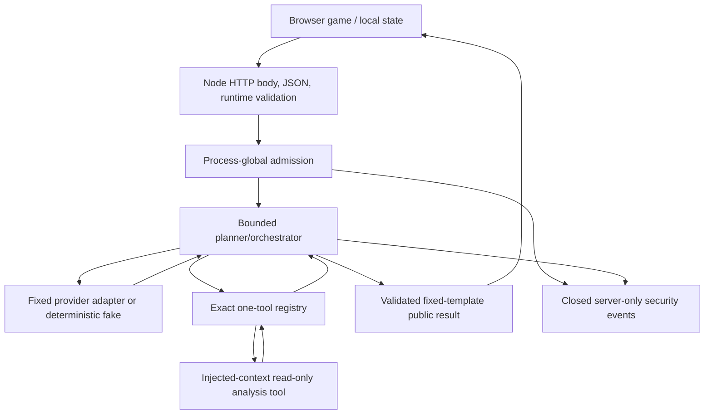

# BRICKPULSE Week 8 Execution Roadmap

## Purpose and authority

This document is the persistent execution tracker for the remaining SITA AI Bootcamp 2026 Week 8 work. It supplements, but does not replace, the authoritative assignment, SpecKit feature, contracts, or final `EVIDENCE_W08.md`.

Authority order for this tracker:

1. `week-08-paket-za-studente-discord/Nedelja-08/02-Nedeljni-zadatak-Secure-the-Arcade.md`
2. `week-08-paket-za-studente-discord/Nedelja-08/03-Sablon-dokaza.md`
3. `specs/003-brickpulse-security/spec.md`
4. `specs/003-brickpulse-security/plan.md`
5. `specs/003-brickpulse-security/tasks.md`
6. W08 contracts, research, quickstart, repository instructions, tests, and factual evidence

Status vocabulary:

- **Implemented**: production or test artifact exists.
- **Tested**: the named check was executed at the recorded checkpoint.
- **Documented**: the decision/result is recorded in an authoritative project artifact.
- **Accepted**: the responsible human has explicitly accepted the task; implementation delegation alone is not final pair review.
- **Not applicable**: a conditional feature genuinely does not exist, with architecture-based reasoning.
- **Blocked**: a required decision, environment, or dependency is unavailable.

Never infer one status from another. A checkbox, commit message, implementation, or historical report alone does not prove all four states.

## Current checkpoint

| Item | Current fact |
|---|---|
| Branch | `008-secure-the-arcade` |
| HEAD | `ae65e8f23dff631857d9b4d03afdd943191a025d` |
| W08 starting checkpoint | `646ddf4adc5158e4a53cdaf296c9627ee0bf5056` |
| W08-027 commit | `ae65e8f` — `test(w08): verify T01 HTTP preflight boundaries` |
| Upstream state at creation | One local commit ahead of `origin/008-secure-the-arcade` |
| Worktree at creation | Clean |
| Current reproduced baseline before W08-027 | 533/533 tests across 38 files; typecheck and production build passed |
| W08-027 focused result | 56/56 `server/app.test.ts` tests passed |
| W08-027 regressions | Validation 34/34; composition 14/14; orchestrator/registry 88/88; W05 34/34; typecheck passed |
| Live providers / credentials | Not used; prohibited for routine W08 work |

### W08-027 completion record

W08-027 added a deterministic test-local planner harness and 28 direct application HTTP-boundary cases:

- 26 malformed, structural, missing-field, wrong-type, or domain-invalid requests;
- exact current HTTP `400` invalid-summary response;
- `providerAttempts = 0` and `executedToolCalls = 0` for every invalid request;
- two valid boundary controls with two provider attempts and one actual permitted read-only tool execution.

All new cases passed immediately. This is regression verification of an existing protection, not a manufactured RED and not a production-code fix. The task is implemented, tested, committed, and accepted by Isidora. Mateja did not perform a final review of this completed work in the recorded workflow.

## Architecture and trust boundaries

Current architecture is a local/public demo with no authentication, session cookie, private-game store, database, leaderboard, or resource-ID lookup API. Browser score/state is untrusted input used for recommendations, not proof of gameplay, identity, privilege, or verified rank. Do not add authentication or persistence merely to satisfy a conditional example.

## Task status audit: W08-001–W08-040

| Task | Implementation | Verification | Documentation / acceptance | Remaining action |
|---|---|---|---|---|
| W08-001 | Implemented as historical conflict record | Git history inspected | SpecKit checkbox stale | Reconcile in W08-040 |
| W08-002 | Narrow W08 authorization implemented | Instruction diff inspected | Checkbox stale | Reconcile in W08-040 |
| W08-003 | Preservation review implemented | Current boundaries inspected | Checkbox stale | Reconcile in W08-040 |
| W08-004 | Authorization checkpoint exists | Git checkpoint verified | H07 review occurred but is not persisted in SpecKit | Record during final reconciliation |
| W08-005 | Admission sliding-window tests exist | Current admission suite passes | Checkbox stale | Preserve evidence; reconcile later |
| W08-006 | Concurrency/idempotence/zero-work tests exist | Current suite passes | Checkbox stale | Preserve evidence; reconcile later |
| W08-007 | Admission controller implemented | Nine admission tests pass | Checkbox stale | None in production |
| W08-008 | Admission composition implemented | Fourteen composition tests pass | Task text still says BLOCKED | Correct stale text only in W08-040 |
| W08-009 | Public 429 contract documented | Static contract review only | Existing artifact records approval; implementation absent | Reconfirm implementation decision before W08-033 |
| W08-010 | W05 control inventory documented | Source/tests inspected | Checkbox stale | Reconcile later |
| W08-011 | Tool-name/argument tests implemented | Registry/orchestrator suites pass | Checkbox stale | None in production |
| W08-012 | Malicious/invalid provider tests implemented | Current suites pass | Checkbox stale | Preserve fixed-goal limitation |
| W08-013 | Result/repetition/budget tests implemented | Current suites pass | Checkbox stale | None in production |
| W08-014 | Cyclic-output hardening implemented | Current suites and W05 pass | Checkbox stale | None in production |
| W08-015 | Tracker lifecycle tests implemented | Six tracker tests pass | Checkbox stale | None |
| W08-016 | Closure-safe tracker implemented | Current tests pass | Checkbox stale | None |
| W08-017 | Raw-operation registration tests implemented | Current tests pass | Checkbox stale | None |
| W08-018 | Provider/tool tracking integrated | Current tests pass | Checkbox stale | Preserve during W08-035 |
| W08-019 | Deadline/cancellation/late-result tests implemented | Current tests pass | Checkbox stale | Add real disconnect proof later |
| W08-020 | Aggregate budgets preserved | Current tests pass | Checkbox stale | None |
| W08-021 | Backend T17 A/B/C implemented | Composition scenario passes | Shared HTTP acceptance absent | Finish in W08-037 |
| W08-022 | Closed-event contract tests implemented | Current event suite passes | Checkbox stale | None |
| W08-023 | Event projector implemented | 52 event tests pass | Checkbox stale | None |
| W08-024 | Event integration implemented | Current suites pass | Marked complete | Preserve |
| W08-025 | Sentinel/newline containment implemented | Current suites pass | Marked complete | Preserve |
| W08-026 | Safe errors/W05 metrics verified | Current suites pass | Marked complete | Preserve |
| W08-027 | Test-only T01 matrix committed | 56/56 focused plus regressions pass | Accepted by Isidora; final Mateja review not claimed | Complete; next task is W08-028 |
| W08-028 | Implemented in uncommitted real-HTTP tests | 12/12 focused plus 101/101 regressions and typecheck pass | Recorded in this tracker | Technically complete; uncommitted |
| W08-029 | Real-browser T04/T05 harness implemented | Three security assertions, existing smoke 7/7, full suite 578/578, and typecheck pass | Recorded in this tracker | Technically complete; uncommitted |
| W08-030 | Test-only T15 integrity proof implemented | 118/118 focused/regression tests and typecheck pass | Recorded in this tracker | Technically complete; uncommitted |
| W08-031 | Production Node static/API serving and security headers implemented | Production tests 78/78, typecheck and build pass | Recorded in this tracker | Implementation complete; final real-browser CSP proof remains W08-039 |
| W08-032 | Applicability assessment and authorized dependency remediation implemented | Full suite 573/573, focused HTTP/app 68/68, typecheck and build pass; both audits clean | Recorded in this tracker | Technically complete; uncommitted |
| W08-033 | Public 429 mapping implemented | RED 2 failures at 503; GREEN/regression 92/92 and typecheck pass | Approved decision and results recorded here | Technically complete; uncommitted |
| W08-034 | Approved 413 mapping implemented | RED 4 failures at 400; GREEN/regression 95/95 and typecheck pass | Approved decision and results recorded here | Technically complete; uncommitted |
| W08-035 | Premature-disconnect signal propagation implemented | RED 2 failures; focused 19/19, lifecycle regressions 164/164, typecheck pass | Approved decision and results recorded here | Technically complete; uncommitted |
| W08-036 | T00 acceptance reproduced | 145/145 focused W03/W05/state tests and browser smoke 7/7 pass | Recorded in this tracker | Technically accepted by Isidora; final Mateja review not claimed |
| W08-037 | Real-HTTP T17 A/B/C chain implemented | HTTP/composition/event 86/86 pass | Recorded in this tracker | Technically complete; uncommitted |
| W08-038 | Verification complete | 40 files / 586 tests, typecheck, build, and both audits pass | Recorded in this tracker | Final review/commit pending |
| W08-039 | Production browser/CSP verification complete | Production script 5/5, browser security 3/3, smoke 7/7 | Recorded in this tracker | Final review/commit pending |
| W08-040 | Evidence/handoff in progress | Root evidence and SpecKit reconciliation prepared | Final Mateja review not performed | Review, corrections, and commit remain pending |

## I1–I8 traceability

| ID | Required invariant | Task mapping | Existing control / test | Remaining evidence | Status |
|---|---|---|---|---|---|
| I1 | Invalid or unauthorized initial HTTP input executes neither provider nor business tool. | 027, 028, 033, 034 | Body/JSON/exact-summary checks precede planner. W08-027 proves invalid counters `0/0`; W08-028 proves actual Node HTTP oversized/privilege rejection before admission/provider/tool. | Later 413 decision and final evidence. | Partially complete |
| I2 | Browser/model cannot choose identity, privilege, provider, tool policy, or limits. | 028, 030, 032 | Exact request schema; server-fixed provider/admission/registry/budgets. | Privileged-field HTTP matrix and T15 proof. | Partially complete |
| I3 | Only exact permitted tool, valid arguments, and permitted scope execute. | 011–014, 028, 037 | Fixed registry, matching context, result normalization; current tests pass. | Actual HTTP/public-scope context evidence and shared T17. | Partially complete |
| I4 | Read-only agent flow does not mutate canonical game state. | 030, 036 | Analysis tool has no mutation interface. | Explicit state-before/after assertion and shared T00. | Missing explicit acceptance |
| I5 | Untrusted content does not become executable browser content. | 029, 031, 039 | Rendering uses `textContent`/text nodes; no rich renderer. | Mandatory real-browser DOM and active CSP evidence. | Missing browser proof |
| I6 | Sizes, calls, time, and concurrency are server-bounded. | 005–008, 015–020, 028, 033–035, 037 | Existing size/budget/admission/tracker controls pass. | Real HTTP size, rate/concurrency, 400/413, and disconnect evidence. | Partially complete |
| I7 | Secrets remain server-side and are excluded from browser/model/log/evidence. | 022–026, 031, 032, 039 | Safe envelopes/events and sentinel tests pass. | Production artifact scan, headers, dependency review. | Partially complete |
| I8 | Normal W05 planner remains usable. | 014, 020, 026, 036, 038, 039 | Current fake flow has two provider decisions and one permitted tool. | Shared/browser acceptance and final regressions. | Partially complete |

## T00–T17 traceability

| ID | Official behavior | Tasks | Existing evidence and counters | Missing work | Status |
|---|---|---|---|---|---|
| T00 | Normal game plus W05 flow; at least two model steps, one real allowed tool, valid result, unchanged state. | 014, 020, 030, 036 | W05 and orchestrator tests: provider `2`, tool `1`. | State before/after, browser game/Planner, shared acceptance. | Partial |
| T01 | Malformed/type/domain-invalid direct request rejects; counters `0/0`; valid boundary passes. | 027 | Commit `ae65e8f`; 26 negative `0/0`; two positive `2/1`; 56/56 focused. | Final evidence consolidation. | Implemented and tested |
| T02 | Oversized and privileged-field cases independently prove policy enforcement. | 028, 034 | W08-028 real HTTP proves exact-boundary success; +1, chunked, and multibyte rejection; six privilege variants reject with admission/provider/tool `0/0/0`. | Later decide 400/413 and consolidate final evidence. | Tested; contract decision pending |
| T03 | Private-resource denial or factual public/demo no-escape proof. | 028 | No users/auth/private resources. Real HTTP proves mismatched model-proposed context executes zero tools and matching server context executes once. | Consolidate public/demo N/A reasoning in final evidence. | Tested; private branch N/A |
| T04 | XSS marker through real rendering stays inert; DOM safe; normal text works. | 029, 039 | Real Chromium proves Coach and Planner hostile markers remain exact inert text, create no active descendants, and execute no marker; legitimate special text is preserved. | Repeat in final W08-039 production acceptance and consolidate evidence. | Tested in development browser; production acceptance pending |
| T05 | Dangerous HTML/Markdown/link stays inactive; text-only UI remains text. | 029, 039 | Real Chromium proves HTML, Markdown, and `javascript:` link syntax remains literal text; no rich renderer exists or was added. | Repeat final browser acceptance with production serving. | Tested in development browser; production acceptance pending |
| T06 | Invalid/oversized provider decision/final cannot succeed or continue. | 012, 014 | Validation/orchestrator tests pass. | Final evidence citation. | Automated proof complete |
| T07 | Unknown and inherited tool names execute zero tools. | 011, 014 | Unknown, `constructor`, `toString`; tool `0`. | Final evidence citation. | Automated proof complete |
| T08 | Invalid/scope-invalid args reject before execution; exact positive succeeds. | 011, 014, 028 | Invalid tool `0`; matching tool `1`. | Public/local context evidence. | Partial |
| T09 | Malicious/injection-directed fake proposal is rejected by execution policy. | 012, 014 | Forbidden proposal rejected; forbidden tool `0`. | Record that no user free-text channel exists and no live-model guarantee is claimed. | Complete with limitation |
| T10 | Invalid/oversized/sentinel tool result cannot reach later model step. | 013, 014, 025 | Result containment tests pass. | Final evidence citation. | Automated proof complete |
| T11 | Repetition and aggregate budgets stop work across retry/fallback. | 013, 020 | Exact step/provider/tool budget tests pass. | Final evidence citation. | Automated proof complete |
| T12 | Per-call timeout, total deadline, cancellation, late settlement, cleanup. | 015–019, 035 | Deferred tracker/orchestrator/composition tests pass. | Actual Node client disconnect and lease evidence. | Partial |
| T13 | Concurrent HTTP work and rate limit cap execution; denial is zero-work; recovery succeeds. | 005–008, 033, 037 | Internal admission/composition proof; denied `0/0`. | Actual HTTP 429, concurrency, rate-window recovery. | Partial |
| T14 | Synthetic secret/log injection absent from response/model/events; safe event remains. | 022–026, 031 | Server containment tests pass. | Production bundle/source-map scan and redacted final evidence. | Partial |
| T15 | Tampered browser/local score grants no authority or verified rank. | 030, 036 | Real HTTP rejects inconsistent score and `verified` claim with `0/0/0`; semantically valid client input returns only planner run/plan without authority fields; detached summary and read-only tool tests preserve canonical state/input. | Consolidate explicit public/demo limitation in final evidence. | Tested; final evidence pending |
| T16 | Production build has real CSP/headers, secret-free assets, blocked-resource proof, working game/AI. | 031, 039 | Production build currently passes. | Production server, headers, browser CSP violation, artifact scan, smoke. | Missing |
| T17 | Multi-boundary A/B/C chain proves denial, events, cleanup, and recovery. | 021, 024, 033, 035, 037 | Backend: A provider `1`/tool `0`; B `0/0`; C provider `2`/tool `1`; release once. | Actual HTTP 429/concurrency and shared acceptance. | Partial |

## Real Node HTTP and browser requirements

### Final traceability reconciliation — 2026-10-27

The earlier I1–I8 and T00–T17 tables preserve the state at roadmap creation. They are superseded for execution status by the reproduced results below and `EVIDENCE_W08.md`:

- I1–I8: technically PASS at the current worktree.
- T00–T17: technically PASS at the current worktree.
- T03's private-resource branch is N/A because the application has no authentication/private resource store/resource lookup; its real public/demo context boundary passed.
- T05 is the applicable text-only rendering branch; no rich renderer was added.
- T09 proves policy enforcement against a deterministic malicious provider proposal and does not claim a live-model guarantee.
- T02/T03/T12/T13/T15/T17 use real Node HTTP; T04/T05/T16 use real Chromium; T16 serves the actual production build.
- Final Mateja review, requested corrections, explicit pair acceptance, and Git commits remain pending. Technical PASS does not imply those human/delivery states.

### Real Node HTTP

In-process `createApp` tests do not prove Node chunk parsing, socket events, actual response headers, TCP concurrency, or browser enforcement. Create a focused `server/http-security.integration.test.ts` harness during W08-028:

- start `node:http.createServer(createNodeHttpHandler(createApp(...)))` on `127.0.0.1` and port `0`;
- use deterministic fake provider/tool/admission counters;
- close the server after each test;
- send real malformed, exact-boundary, oversized, multibyte, chunked, and privileged payloads;
- later reuse it for 429, 400/413, disconnect, and A/B/C scenarios;
- if loopback binding fails, record exact error and `BLOCKED`; never substitute an in-process PASS.

Required network observations:

- exact HTTP status, body, and relevant headers;
- provider attempts and executed tools;
- admission attempts, active count, and release count where applicable;
- ordered closed security events;
- no internal reason/policy leakage;
- later healthy request after drain or rate-window expiry.

### Real browser

Create focused browser scripts in their authorized tasks:

- `scripts/w08-browser-security.mjs` for T04/T05;
- `scripts/w08-production-security.mjs` for T16.

T04/T05 must use a real browser and actual DOM assertions for harmless ``, `<svg onload>`, script-shaped text, `javascript:` text, Serbian letters, apostrophes, and `a < b`. Absence of an alert alone is insufficient.

T16 must use the built `dist`, a production Node serving path, active CSP, `X-Content-Type-Options: nosniff`, explicit `Referrer-Policy`, a controlled reachable resource blocked specifically by CSP, a synthetic-only artifact scan, and working game/Coach/Planner flows. Vite development headers and a 404 are not acceptable substitutes.

## Three before/after evidence candidates

1. **T13/T17 admission and recovery**
   - Before: checkpoint before `2800a9c`, with no process-wide admission controller.
   - After: final checkpoint using the same deterministic A/B/C fixture.
   - Evidence: A reaches provider and forbidden proposal is denied; B has provider/tool `0/0`; release occurs once after drain; C succeeds.

2. **T07/T09 allowlist plus safe events**
   - Before: existing W05 exact-registry rejection at the pre-W08 checkpoint.
   - After: same forbidden proposal plus closed W08 event evidence.
   - This is a regression/control comparison, not a claim that a vulnerability was intentionally present.

3. **T10/T14 invalid result and containment**
   - Before: existing tool-result validator rejects unexpected output.
   - After: same fixture demonstrates containment across final result, later model call, safe event, and public response.
   - Synthetic sentinel text must never be copied into submitted evidence.

Actual commands/results for these comparisons belong in `EVIDENCE_W08.md`; this tracker records candidates only.

## Dependency-aware execution order

1. W08-028 — T02/T03 and real Node HTTP harness
2. W08-032 — CORS/CSRF and dependency review
3. W08-030 — T15 game-state integrity
4. W08-029 — T04/T05 real-browser rendering
5. Reconfirm the documented W08-009 429 implementation decision
6. W08-033 — public 429 implementation
7. W08-034 — 400/413 decision and implementation
8. W08-035 — request-disconnect lifecycle
9. W08-031 — production serving, CSP, and headers
10. W08-036 — shared T00 acceptance
11. W08-037 — shared HTTP T17 acceptance
12. W08-038 — final deterministic suite
13. W08-039 — real-browser/CSP acceptance
14. W08-040 — final evidence, SpecKit reconciliation, demo, and handoff

### Authorized sequential-continuation policy

Effective 2026-10-27, Isidora authorized execution to continue through the dependency order in one session, while keeping each task an independently reviewable checkpoint. For every task: verify Git state; inspect the governing requirement; make only the task-scoped change; add deterministic negative and positive tests; run focused checks and applicable regressions; inspect the diff; record actual results here; and only then begin the next task. A failed required check blocks successor work until safely corrected.

This authorization supersedes the earlier interaction-level pause rule in this tracker. It does not broaden technical scope or authorize commits, pushes, merges, live providers, credentials, `.env` access, `npm run check`, new dependencies, invented evidence, or false completion claims. A new public contract, significant architecture redesign, new dependency, or unrelated change to Mateja-owned internals remains a mandatory human-decision stop. Mateja's final review is recorded only if it actually occurs.

## Remaining task specifications

### W08-028 — T02/T03 body, privilege, and resource boundaries

- **Prerequisites:** W08-027 commit `ae65e8f`; clean checkpoint.
- **Likely files:** `server/app.test.ts`; new `server/http-security.integration.test.ts`; existing validation/registry fixtures.
- **Test-first cases:** exact 16 KiB, 16 KiB+1, multibyte boundary, chunked crossing; otherwise-valid bodies with `role`, `ownerId`, `maxSteps`, `provider`, `model`, nested policy; matching/mismatched context IDs.
- **Assertions:** current over-limit contract remains 400 during this task; privilege fields reject independently; provider/tool/admission `0/0/0`; policy constants unchanged; mismatched context tool `0`; matching context tool `1`.
- **Commands:** `npm test -- server/app.test.ts server/http-security.integration.test.ts`; validation/registry regressions; typecheck; `git diff --check`.
- **Evidence:** exact bytes/chunks, real URL, status/body, counters, public/local T03 reasoning.
- **Forbidden:** authentication, database, 413, 429, abort, admission redesign, unrelated production change.
- **Stop:** report TCP failure as BLOCKED; stop before W08-034.

### W08-032 — CORS/CSRF and dependency review

- **Prerequisites:** installed lockfile environment.
- **Likely files:** documentation/evidence later; inspect `server/index.ts`, `vite.config.ts`, browser transports, package files.
- **Checks:** no session/cookie/bearer/ambient credential; intended same-origin production; public endpoint still needs admission; CORS is not authentication.
- **Commands:** `npm audit --json`, `npm ls --all`, `npm outdated` where network permits.
- **Evidence:** package/version/advisory/reachability/runtime-or-dev/decision; CSRF applicability rationale.
- **Forbidden:** `npm audit fix`, `--force`, package/lock update, authentication, CSRF framework.
- **Stop:** remediation requires its own approved task.

Observed 2026-10-27 assessment:

- Both browser transports use relative same-origin `POST /api/...` requests with JSON and do not set `credentials`, `Authorization`, or another bearer/session header.
- The Node API sets no cookies, has no authentication/session state, and emits no CORS allow-origin headers. The intended production topology is same-origin; the Vite development proxy forwards `/api` to loopback. CSRF does not protect user-specific authority here because no ambient credential or authenticated state-changing operation exists. CORS must not be represented as authentication; admission and validation remain necessary for the public/demo endpoint.
- `package-lock.json` is lockfile v3 with 145 package records. `npm ls --all` completed; reported unmet packages are optional platform/peer capabilities, not required runtime installation failures.
- `npm audit --json` reported 5 vulnerable dependency entries: 2 critical, 2 high, and 1 moderate. Affected paths are development-only: `vitest`/`tinypool`/`@vitest/mocker`, plus `vite` and its `postcss -> source-map-js` path. The production `@google/genai` dependency tree was not identified in the report.
- The offered Vitest remediation is `vitest@5.0.5`, a semver-major change. No package, lockfile, or installed version was changed. Dependency remediation requires a separate explicit decision and full regression verification.

#### Dependency remediation gate — detailed findings

Commands executed on 2026-10-27:

- `npm audit --json`
- `npm audit --omit=dev --json`
- `npm explain source-map-js tinypool @vitest/mocker vite vitest`
- read-only `npm view` version queries for Vite 7, Vitest 3/4, Tinypool, `@vitest/mocker`, and `source-map-js`

`npm audit --omit=dev --json` reported **0 production vulnerabilities**. The five top-level audit entries and all advisories underneath them are development-only paths:

| Audit entry / installed path | Directness | Advisory and exploit condition | Affected / fixed | Applicability and decision |
|---|---|---|---|---|
| `vite@7.3.6` | Direct dev dependency | GHSA-698v-4r3x-3vcv / CVE-2026-112943: Windows `launch-editor` command injection requires attacker-controlled filename plus environment-variable or NTFS-stream influence. GHSA-r825-w8mm-5pxw / CVE-2026-112944: editor argument interpreted as a CLI flag requires an attacker-created `+`/`-` path and a susceptible editor. GHSA-587h-7wmj-h5pm / CVE-2026-112942: Windows crafted `\\..:line:column` bypass can combine with the escaping issue. GHSA-9jrq-w75r-8gcw / CVE-2026-112945: cross-origin script execution requires custom/middleware-mode `transformIndexHtml`, inline module script, and sensitive browser-origin state. GHSA-rq7h-c2jc-7f22 / CVE-2026-112946: filesystem disclosure requires network exposure, a path collision import, and a non-Windows host. | Vite `>=7.0.0 <=7.3.6`; fixed `7.3.7`. | This project uses normal SPA mode, no custom middleware, has no browser secrets/session, and currently runs on Windows. Several exploit preconditions are absent, but the direct dev server remains affected code. Compatible patch `7.3.7` exists. |
| `source-map-js@1.2.1` through `vite -> postcss` | Transitive dev dependency | GHSA-68fv-2mgg-jv7q / CVE-2026-93749: an attacker-supplied indexed source map with an extreme section offset can synchronously block the event loop. | `>=1.0.0 <1.2.2`; fixed `1.2.2`. | The project does not accept untrusted source maps through its application API; exposure is build-tool only. Compatible transitive patch `1.2.2` exists. |
| `@vitest/mocker@3.2.7` through `vitest` | Transitive dev dependency | GHSA-82fw-gwwq-j7x9 / CVE-2026-84373: a client reaching an unauthenticated mocker/interceptor WebSocket can redirect a mock outside the project and read local files; normal Vitest browser RPC is token-authenticated by default. GHSA-qxg6-89mg-rqv8 / CVE-2026-112949: the same directly exposed plugin surface permits unauthenticated manual-mock JavaScript injection into the developer-browser origin. | First fixed `4.1.11`; second fixed `4.1.12` (also fixed in 5.x). No fixed 3.x release. | This project does not directly invoke `mockerPlugin`/`interceptorPlugin` and does not currently use Vitest browser mode, reducing reachability. Remediation still requires a Vitest major upgrade. |
| `tinypool@1.1.1` through `vitest` | Transitive dev dependency | GHSA-5gmw-xhrv-c9v3 / CVE-2026-104848: an existing prototype-pollution primitive can inject inherited worker `execArgv`/`env`, producing code execution in test/CI workers. GHSA-85c8-ppgw-ccpr / CVE-2026-104849: polluted `Object.prototype.filename` can redirect `pool.run(task, options)` to an attacker worker when a caller supplies an options object. | First fixed `2.1.1`; second fixed `2.1.2`. | No application request reaches Vitest/Tinypool, and no known project prototype-pollution path feeds test runner options. Impact remains critical on developer/CI hosts if those prerequisites arise. Vitest 3 pins Tinypool 1.x, so a supported fix requires a Vitest major upgrade. |
| `vitest@3.2.7` | Direct dev dependency | Aggregate entry inherits the `@vitest/mocker` and Tinypool advisories above. | No patched Vitest 3 release. Minimum line satisfying all currently listed components is Vitest `4.1.12`; `npm audit` recommends `5.0.5`. | Major-upgrade stop applies. Do not install automatically. |

Remediation options requiring human selection:

1. **Recommended:** authorize a separately scoped upgrade from `vitest@^3.2.4` to `vitest@4.1.12` (the smallest stable major that satisfies the listed Vitest/mocker fixes and carries a patched Tinypool line), plus Vite `7.3.7` and `source-map-js` `1.2.2` as resolved by the refreshed lockfile. The current Node `v24.20.0` satisfies the newer toolchain baseline. Repository inspection found only standard imports from `vitest`, no browser mode, coverage provider, custom pool/reporter/environment, or removed internal Vitest entry point, so expected compatibility risk is limited but non-zero; Vitest 4 changes advanced pool/config APIs and test execution internals. Inspect the official migration notes first, then run the full deterministic suite, typecheck, build, W08-027, and W08-028 real-HTTP tests.
2. Upgrade to the audit-suggested `vitest@5.0.5`, which is a larger compatibility jump and therefore not the minimum preferred remediation.
3. Temporarily accept documented development-only residual risk: keep Vite/Vitest bound to loopback, do not expose test/dev servers, do not directly mount Vitest mocker plugins, run only trusted tests/source maps, keep credentials out of test processes, and schedule the major upgrade before shared final acceptance. This does not make the audit clean.

The major upgrade was explicitly authorized and executed. `package.json` now pins `vite` to `7.3.7` and `vitest` to `4.1.12`; the refreshed lock resolves `@vitest/mocker@4.1.12` and `source-map-js@1.2.2`, and no Tinypool package remains installed. `npm audit --json` and `npm audit --omit=dev --json` both report zero vulnerabilities. The complete deterministic suite passed 39 files / 573 tests; typecheck and production build passed; the real-HTTP/app security regression passed 2 files / 68 tests. No Vitest compatibility code or configuration change was required.

### W08-030 — T15 game-state integrity

- **Prerequisites:** W08-027 and verified tool controls.
- **Likely files:** `src/ai/game-summary.test.ts`, `server/ai/training-tool.test.ts`, optionally route tests.
- **Fixtures:** tampered high score, inconsistent rejected summary, deep state snapshot, normal terminal summary.
- **Assertions:** no verified-rank/authority field; no policy escalation; inconsistent input `0/0`; read-only tool leaves input/canonical state unchanged; valid metrics remain.
- **Commands:** focused game-summary/game/tool/app tests and typecheck.
- **Evidence:** state before/after and explicit unverified-score limitation.
- **Forbidden:** leaderboard, authentication, server game engine, anti-cheat, gameplay change.
- **Stop:** review before T00 acceptance.

### W08-029 — Real-browser T04/T05

- **Prerequisites:** TCP/browser-capable environment.
- **Likely files:** new `scripts/w08-browser-security.mjs`; production UI only if a genuine defect is demonstrated.
- **Fixtures/assertions:** harmless XSS/HTML/URL markers remain inert; no dangerous DOM; normal special text visible; no browser errors.
- **Command:** `node scripts/w08-browser-security.mjs`.
- **Evidence:** browser/version, URL, DOM assertions, marker state, output.
- **Forbidden:** sanitizer dependency, rich renderer, framework, unit-only PASS.
- **Stop:** environment failure is BLOCKED.

### W08-033 — Public 429

- **Prerequisites:** documented 429 decision reconfirmed for implementation; W08-028 HTTP harness.
- **Likely files:** `server/app.ts`, route/network tests, browser transport tests only if explicit 429 parsing is chosen.
- **RED:** exact 429 tests fail against current 503.
- **GREEN:** both internal denial reasons map to one public code/message/zero-counter run; no internal reason or `Retry-After`; 200/400/422/503 unchanged.
- **Commands:** route, network, transport/controller, composition tests; typecheck.
- **Evidence:** RED/GREEN response, counters, decision reference.
- **Forbidden:** 413, abort, admission algorithm, new policy fields.
- **Stop:** shared-contract diff review; final Mateja review remains factual/pending until performed.

### W08-034 — 400 versus 413

- **Prerequisites:** W08-028 evidence and explicit implementation decision.
- **Proposed policy:** over 16 KiB returns 413; malformed/schema/domain-invalid within limit remains 400; retain a closed safe body unless separately changed.
- **Likely files:** `server/app.ts`, application/network tests, approved contract documentation later.
- **RED/GREEN:** exact 413 tests must fail against current 400, then minimal mapping.
- **Assertions:** exact and +1 byte, multibyte, chunked crossing; response once; downstream `0/0`; no retained excess body.
- **Commands:** app/network tests, typecheck, diff check.
- **Forbidden:** new dependency, 429/abort change, diagnostic leakage.
- **Stop:** without explicit decision, preserve 400.

### W08-035 — Request disconnect

- **Prerequisites:** W08-018 verified; real HTTP harness; explicit lifecycle decision.
- **Proposed behavior:** proven premature disconnect propagates a server-owned signal; normal close does not; lease releases only after raw tracked work drains.
- **Likely files:** `server/app.ts`, network tests, minimal approved signal interface in composition, lifecycle tests.
- **Fixtures:** abort-aware/ignoring provider, abort-ignoring tool, never-settling fake, normal success.
- **Assertions:** no new work, no late success, no early/double release, recovery after settlement, no double response.
- **Commands:** network/app, composition/tracker/orchestrator tests; typecheck.
- **Forbidden:** route-level lease release or claim of remote cancellation/billing cessation.
- **Stop:** review event semantics and preservation of Mateja-owned lifecycle.

### W08-031 — Production serving, CSP, and headers

- **Prerequisites:** stable shared route contracts.
- **Likely files:** `server/index.ts`, small Node-native static handler, focused tests, `scripts/w08-production-security.mjs`.
- **Policy baseline:** `default-src 'self'; script-src 'self'; style-src 'self'; img-src 'self' data:; connect-src 'self'; object-src 'none'; base-uri 'none'; frame-ancestors 'none'`; `nosniff`; `Referrer-Policy: no-referrer`.
- **Tests:** built assets served; traversal rejected; API preserved; controlled reachable script blocked by CSP; game/AI work; artifact scan excludes synthetic sentinel.
- **Commands:** build, production-server tests, production browser script.
- **Forbidden:** Express/framework/dependency, deployment, HTTPS infrastructure, live provider, dev-server proof.
- **Stop:** TCP/browser failure is BLOCKED.

### W08-036 — T00 acceptance

- **Prerequisites:** W08-030 and backend controls.
- **Files:** tests/evidence unless a real regression is demonstrated.
- **Assertions:** game works; two provider/model decisions; one permitted tool; validated plan/metrics; unchanged state; Coach independent.
- **Commands:** W05 eval, game, app/integration, orchestrator/tool tests.
- **Evidence:** counters, state before/after, plan, Isidora acceptance; Mateja final review not claimed unless performed.
- **Forbidden:** live provider or gameplay redesign.
- **Stop:** no automatic successor.

### W08-037 — T17 HTTP acceptance

- **Prerequisites:** backend T17, events, 429, applicable disconnect behavior.
- **Likely file:** `server/http-security.integration.test.ts`.
- **Fixtures:** capacity-one A forbidden proposal; B during held lease; A settlement; C normal success.
- **Assertions:** A provider `1`/tool `0`; B HTTP 429/provider `0`/tool `0`; one release after drain; C provider `2`/tool `1`; safe ordered events.
- **Commands:** network/composition/event/orchestrator tests.
- **Evidence:** ordered responses/events/counters/recovery.
- **Forbidden:** claim B reached provider, production capacity change, raw event data.
- **Stop:** shared acceptance remains pending final review.

### W08-038 — Final deterministic suite

- **Prerequisites:** W08-028–037 applicable work complete.
- **Commands:** focused W08 suites, W03 formal/holdout, W05 eval, `npm test`, typecheck, build, `git diff --check`.
- **Evidence:** exact totals, duration, checkpoint, failures/blocks.
- **Forbidden:** live provider, `.env`, `npm run check:frontend-boundary`, opportunistic fixes.
- **Stop:** unexplained failure blocks W08-039/040.

### W08-039 — Final browser/CSP acceptance

- **Prerequisites:** W08-029, W08-031, W08-038.
- **Commands:** browser-security and production-security scripts.
- **Assertions:** T04/T05 inert DOM; T16 headers/CSP/block; secret-free assets; game/AI positive controls.
- **Evidence:** environment, URL, headers, CSP console violation, DOM state, artifact scan, useful screenshots.
- **Forbidden:** 404-as-CSP proof, bypassed policy, dev-server substitution, false PASS.
- **Stop:** unavailable environment is BLOCKED.

### W08-040 — Evidence, SpecKit, demo, and handoff

- **Prerequisites:** W08-038 and W08-039 completed or honestly blocked; implementation diffs reviewed.
- **Likely files:** new root `EVIDENCE_W08.md`; approved existing SpecKit/checklist/research/quickstart updates; this tracker; preserve `docs/mateja-w08-evidence.md`.
- **Evidence requirements:** checkpoint, diagram/data inventory, at least six risks and three priorities, I1–I8, T00–T17, concrete limits, commands/counters, three before/after cases, browser/CSP, CORS/CSRF, dependency findings, regressions, contributions, AI use, limitations.
- **SpecKit:** correct stale task/status wording only from reproduced evidence; no duplicate feature directory.
- **Demo:** eight-minute runbook and individual-defense talking points.
- **Commands:** final status/log/diff checks and only the verification needed to support evidence.
- **Forbidden:** invented PASS, raw secret/sentinel/payload, invented approval, push/merge.
- **Stop:** record Mateja review only if it actually occurs; perform requested corrections before final acceptance.

## Outstanding official deliverables

- Final threat model with at least six concrete risks and three prioritized risk themes.
- Final trust-boundary diagram and field-level data inventory.
- Completed I1–I8 enforcement/test/evidence matrix.
- Completed T00–T17 expected/observed/counter/status matrix.
- Three factual before/after comparisons using the same fixtures and identifiable checkpoints.
- Real-browser T04/T05.
- Actual production T16 with CSP, headers, blocked-resource proof, and working game/AI.
- CORS/CSRF applicability and dependency review.
- W03–W05 regression preservation.
- Updated existing SpecKit artifacts and checklists.
- Root `EVIDENCE_W08.md` following the official template.
- One implemented protection and negative test attributable to each collaborator.
- Eight-minute demo rehearsal and individual defense preparation.
- Final limitations/residual-risk statement.
- Final Mateja review recorded factually if/when performed.

## Final acceptance checklist

- [ ] All applicable W08 implementation tasks are separately reviewed.
- [ ] T00–T15 and T17 automated coverage exists as required.
- [ ] Full test suite passes at the final checkpoint.
- [ ] Typecheck passes.
- [ ] Production build passes.
- [ ] W03 game, W04 Coach, and W05 Planner regressions pass.
- [ ] Real Node HTTP malformed, privilege, oversized, 429, concurrency, recovery, and approved disconnect tests run.
- [ ] T04/T05 real-browser tests pass or are honestly BLOCKED.
- [ ] T16 production CSP/header/browser proof passes or is honestly BLOCKED.
- [ ] I1–I8 and T00–T17 map to actual evidence.
- [ ] Dependency findings are classified and addressed or documented.
- [ ] No real credential, live provider, `.env`, or forbidden check was used.
- [ ] Three factual before/after comparisons are complete.
- [ ] Root evidence follows the official template.
- [ ] SpecKit and task status are consistent with reproduced facts.
- [ ] Git diff is intentional and passes `git diff --check`.
- [ ] Demo and individual defense are prepared.
- [ ] Mateja final review is recorded only if actually performed.
- [ ] Requested corrections are completed and reverified.
- [ ] Final acceptance is explicit; delegation is not represented as final review.

## Progress log

Update this table after each approved task. Record actual results only.

| Date | Task | Start checkpoint | Files changed | Expected result | Observed result | Verification | Commit | Review / limitations | Next authorized task |
|---|---|---|---|---|---|---|---|---|---|
| 2026-10-27 | W08-027 | `d75faaf` | `server/app.test.ts` | T01 invalid `0/0`; valid `2/1` | 26 invalid and 2 valid cases passed immediately; existing protection verified | App 56/56; validation 34/34; composition 14/14; orchestrator/registry 88/88; W05 34/34; typecheck and diff check passed | `ae65e8f` | Accepted by Isidora; no production change; no final Mateja review claimed | W08-028 |
| 2026-10-27 | W08-028 | `ae65e8f` | `server/http-security.integration.test.ts`, this tracker | T02 real HTTP byte/privilege enforcement; T03 public/demo context no-escape | 12/12 focused passed: exact 16 KiB valid request `1/2/1` admission/provider/tool; +1, chunked, multibyte and six privilege variants `0/0/0`; mismatched context `1/1/0`, matching `1/2/1` | Focused 12/12; app/validation/registry 101/101; typecheck passed | Uncommitted | Initial sandbox run blocked at Vite config access; identical approved run passed. Current oversized response remains 400. No private per-user resources exist. | W08-032 |
| 2026-10-27 | W08-032 remediation gate | `ae65e8f` plus uncommitted W08-028 | This tracker only | Determine smallest safe remediation without automatic major upgrade | Production audit 0; full audit 5 dev entries. Vite 7.3.7 and source-map-js 1.2.2 are compatible fixes, but Vitest 3 has no patched release; minimum identified stable major is 4.1.12. | Full/production audit, dependency paths, registry versions, and official advisory conditions reviewed; package/lock diff empty | Uncommitted | Major-upgrade stop triggered. No tests/build rerun because no dependency changed. | BLOCKED pending Vitest-major decision |
| 2026-10-27 | W08-032 dependency remediation | `ae65e8f` plus uncommitted W08-028 | `package.json`, `package-lock.json`, this tracker | Install smallest authorized patched toolchain and clear all audit findings | Installed Vite 7.3.7, Vitest/mocker 4.1.12, source-map-js 1.2.2; Tinypool removed; full and production audits report 0 | Full suite 39 files/573 tests; typecheck pass; build pass (13 modules); HTTP/app 2 files/68 tests | Uncommitted | No compatibility edits needed; no final Mateja review claimed | W08-030 |
| 2026-10-27 | W08-030 | `ae65e8f` plus uncommitted W08-028/032 | `server/http-security.integration.test.ts`, `server/ai/training-tool.test.ts`, `src/ai/game-summary.test.ts`, this tracker | T15 rejects inconsistent/authority claims and proves read-only/detached state | Inconsistent `score:999` and extra `verified:true` reject at real HTTP with admission/provider/tool `0/0/0`; valid client report yields planner data but no verified/rank/owner/authority field; summary mutation and tool analysis leave canonical/input data unchanged | Focused/regression 5 files/118 tests; typecheck pass | Uncommitted | First positive fixture got safe 422 because its scripted completed-clear proposal did not fit GAME_OVER; corrected to a valid WON positive control. No production change. | W08-029 |
| 2026-10-27 | W08-029 | `ae65e8f` plus uncommitted W08-028/032/030 | `scripts/w08-browser-security.mjs`, this tracker | Real-browser T04/T05 inert rendering with positive text controls | Chromium rendered hostile Coach/Planner HTML, Markdown, SVG, script, and javascript-link syntax as exact text; no active descendant or marker execution; legitimate `<`, `&`, and quotes preserved | Security script 3 PASS assertions; existing smoke 7/7; typecheck pass; final current suite 39 files/578 tests | Uncommitted | Development Vite browser proof only; production CSP/headers remain W08-031/W08-039. No final Mateja review claimed. | Public 429 contract gate before W08-033 |
| 2026-10-27 | W08-033 | `ae65e8f` plus prior uncommitted checkpoints | `server/app.ts`, `server/http-security.integration.test.ts`, this tracker | Both closed admission reasons map to one safe 429 with zero provider/tool work | Initial RED: both cases received 503. GREEN: rate and concurrency denial receive exact 429 body, no `Retry-After` or reason leakage, admission/provider/tool `1/0/0`; existing contracts preserved | Route/HTTP/composition/transport 4 files/92 tests; typecheck pass | Uncommitted | Admission algorithm unchanged; browser transport already fails closed for non-200 and needed no change. | W08-034 |
| 2026-10-27 | W08-034 | `ae65e8f` plus prior uncommitted checkpoints | `server/app.ts`, `server/app.test.ts`, `server/http-security.integration.test.ts`, this tracker | Approved 413 for bodies above 16 KiB with safe envelope and zero work | Initial RED: app and single/chunked/multibyte network cases received 400. GREEN: all oversize cases receive 413; exact 16 KiB valid request remains 200; in-limit malformed/domain-invalid remain 400; zero-work counters preserved | HTTP/app/integration/client 5 files/95 tests; typecheck pass | Uncommitted | One pre-existing parameterized app test combined 400 and oversize cases; split expected statuses without weakening either assertion. | W08-035 |
| 2026-10-27 | W08-035 | `ae65e8f` plus prior uncommitted checkpoints | `server/app.ts`, `server/composition.ts`, `server/ai/training-orchestrator.ts`, `server/http-security.integration.test.ts`, this tracker | Approved premature-disconnect cancellation with tracker-owned fail-closed lease | Initial RED: normal request had no signal and disconnect did not abort provider. GREEN: normal response leaves signal live; destroyed client aborts provider-facing signal; abort-ignoring raw work keeps active count 1 and next request 429; after raw settlement active count becomes 0 and next request succeeds; no late response is written | Focused real HTTP 19/19; app/composition/orchestrator/tracker/registry 5 files/164 tests; typecheck pass | Uncommitted | Route never releases leases. Cancellation is local intent only and does not claim remote work/billing termination. Never-settling raw work remains fail-closed by the unchanged tracker design. | W08-031 |
| 2026-10-27 | W08-031 | `ae65e8f` plus prior uncommitted checkpoints | `server/production-server.ts`, `server/production-server.test.ts`, `server/index.ts`, this tracker | Serve built frontend/API on one origin with enforceable security headers and traversal protection | Built index/assets served with CSP, nosniff, no-referrer, DENY framing, permissions policy, MIME/cache controls; encoded traversal 404; API delegated with headers | Production/HTTP/app 3 files/78 tests; typecheck pass; build pass (13 modules) | Uncommitted | Tests were added immediately after implementation rather than producing a pre-implementation RED; no RED is claimed. First verification found and removed one unused type import. Active browser CSP/block proof remains W08-039. | W08-036 |
| 2026-10-27 | W08-036 | `ae65e8f` plus prior uncommitted checkpoints | This tracker only | Reproduce T00 normal game and W05 two-step/one-tool read-only flow | Existing deterministic acceptance proves 2 model steps, 2 provider attempts, 1 permitted tool, validated evidence/plan; W08-030 proves state/input immutability; browser smoke proves game, Coach, and Planner remain usable | Focused W03/W05/state 5 files/145 tests; real-browser smoke 7/7 | Uncommitted | Verification-only existing protection; no new RED or production change. Final Mateja review not claimed. | W08-037 |
| 2026-10-27 | W08-037 | `ae65e8f` plus prior uncommitted checkpoints | `server/http-security.integration.test.ts`, this tracker | T17 real-HTTP A/B/C chain with closed security events | A admitted and held capacity; B received exact zero-work 429 with provider/tool unchanged; A's forbidden `delete_database` proposal received 422 and zero tool execution; after cleanup C completed with total provider/tool `3/1`; closed admitted/denied/tool-denied/completed events observed without hostile tool name | HTTP/composition/security-events 3 files/86 tests | Uncommitted | Uses deterministic deferred fake; no live provider. Final Mateja review not claimed. | W08-038 |

| 2026-10-27 | W08-038 | `ae65e8f` plus prior uncommitted checkpoints | This tracker only | Reproduce the full deterministic baseline and dependency state | All deterministic tests, typecheck, production build, and both audits passed | 40 files/586 tests; typecheck pass; build pass (13 modules); `npm audit` 0; `npm audit --omit=dev` 0 | Uncommitted | No live provider, credentials, `.env`, or forbidden check used | W08-039 |
| 2026-10-27 | W08-039 | `ae65e8f` plus prior uncommitted checkpoints | `scripts/w08-production-security.mjs`, this tracker | Actual built-site CSP/header/asset/AI proof plus real-browser T04/T05 | Production game and both fake-backed AI flows worked; required headers were present; controlled second-origin script was reachable but blocked by CSP; isolated synthetic server configuration was loaded and absent from HTTP/build output | Production security 5/5; browser security 3/3; smoke 7/7 | Uncommitted | Real Chromium against actual `dist`; textual automated evidence, no fabricated screenshot; no live provider | W08-040 |
| 2026-10-27 | W08-040 | `ae65e8f` plus all uncommitted W08 checkpoints | `EVIDENCE_W08.md`, SpecKit status artifacts, this tracker | Reconcile actual evidence and prepare handoff/demo without claiming unperformed review | Root evidence and status reconciliation prepared; final Mateja review, requested corrections, explicit pair acceptance, and commits remain pending | Final diff and verification reported at handoff | Uncommitted | Week 8 is not final/accepted until the pending human review and Git checkpoints occur | Human review |
| 2026-10-27 | Final independent acceptance audit | `ae65e8f` plus all uncommitted W08 checkpoints | `scripts/w08-production-security.mjs`, `EVIDENCE_W08.md`, SpecKit reconciliation, this tracker | Independently challenge every assignment claim and close factual evidence gaps | Corrected contributor name; added loaded synthetic-server-config containment proof; exact mapping/demo and checkpoint-based comparisons; no technical acceptance failure found | 586/586; HTTP 20/20; browser 3/3; production 5/5; smoke 7/7; typecheck/build pass; audits 0/0; diff check pass | Uncommitted | Browser smoke and real orchestrator proof are separate; Mateja final review and Git delivery remain pending | Human review |

## Current execution task: W08-040 handoff review

Technical implementation and reproducible verification through W08-039 are complete. W08-040 documentation is prepared, but final Mateja review, any requested corrections, explicit pair acceptance, and commits are still pending. No such review or acceptance is inferred from implementation delegation.

### Approved shared HTTP/lifecycle decisions — 2026-10-27

- **W08-033 / 429:** both `rate_limited` and `concurrency_limited` map to HTTP 429 with the documented zero-work `admission_denied` run and `TRAINING_PLAN_ADMISSION_DENIED` safe message. Internal reasons/policy and `Retry-After` remain absent; 200/400/422 and non-admission 503 remain unchanged.
- **W08-034 / 413:** bodies exceeding 16 KiB map to HTTP 413 while exactly 16 KiB remains accepted when otherwise valid. Malformed/schema/domain-invalid in-limit input remains 400. The existing safe invalid-summary envelope is retained. Oversize rejection performs admission/provider/tool `0/0/0` and preserves bounded, single-response buffering.
- **W08-035 / disconnect:** confirmed premature client disconnect propagates a server-owned cancellation signal; normal completion does not. Route code never releases the lease. The existing tracker retains the lease until registration closes and all raw work settles; abort-ignoring or never-settling work remains fail-closed without late success, double response, double release, or replacement capacity. Local cancellation makes no remote-cancellation or billing guarantee.

These are implementation authorizations for the existing roadmap, not evidence that the tasks already pass.
