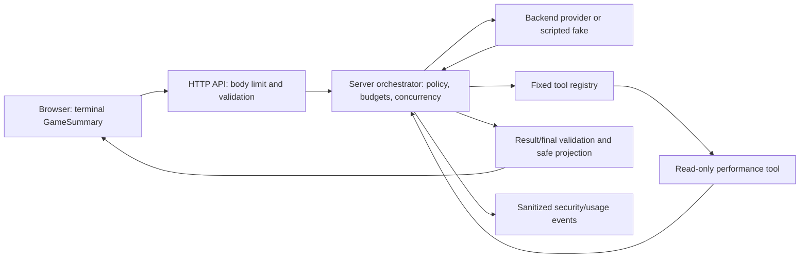

# Feature Specification: BrickPulse Secure the Arcade

**Feature branch**: `008-secure-the-arcade`
**Created**: 2026-10-26
**Status**: Draft for pair review — specification only
**Source authority**: W08 “Secure the Arcade” assignment supplied by the user; preserved W03–W05 specifications and repository instructions.

## Scope and non-goals

This additive W08 feature hardens the existing, bounded W05 Training Planner from browser request through safe browser display. It preserves the game, `/api/ai/advice`, the W05 planner’s successful path of two model decisions and one real `analyze_game_performance` execution, and its backend ownership.

This specification authorizes no implementation, dependency installation, provider call, test execution, commit, or alteration of historical W03–W05 evidence. It does not add authentication, persistence, a database, a provider, a new agent/tool, a rich-text renderer, arbitrary browser policy, or a gameplay redesign.

## Baseline checkpoint

- Branch/commit before W08 changes: `main` at `646ddf4adc5158e4a53cdaf296c9627ee0bf5056`.
- W08 branch: `008-secure-the-arcade`.
- Confirmed baseline: `npm test` 423 passing tests; typecheck and build passed; focused W05 fake-provider evaluation passed 34 tests.
- Environment limitation: smoke was blocked by local TCP bind `EPERM`; it is not a passing result. The existing frontend-boundary command was not run because it can read a real key.
- All W08 routine verification MUST be credential-free and network-free, using fakes and synthetic fixtures only.

## User goal

> A legitimate completed-game request still produces a grounded training plan, while hostile browser input, malicious model output, oversized/concurrent work, unsafe display content, and secret-bearing errors are stopped at the owning boundary.

## Actual trust boundaries

The browser may supply an untrusted terminal summary but does not select a provider, model, tool, run budget, policy, context ID, or server configuration. The provider returns untrusted `unknown`; it never executes a tool itself. The fixed registry injects the validated summary into the one permitted local tool. Only validated public DTOs cross back to the browser, which renders displayed strings via `textContent`.

## Invariants

| ID | Mandatory rule | Observable acceptance implication |
|---|---|---|
| I1 | An initial HTTP request that fails body, JSON, structural, domain, or applicable access validation executes neither provider nor tool. | Rejected direct requests report zero provider attempts and zero tool calls. |
| I2 | Browser and model cannot choose identity, privilege, provider configuration, tool policy, or security limits. | Extra client/model policy fields do not change server behavior; fixed server choices remain in force. |
| I3 | A tool executes only when its exact permitted name, exact valid arguments, and permitted current-run scope all pass server validation. | Unknown/inherited names, extra/wrong-context arguments, and repeat/scope failures have zero prohibited execution. |
| I4 | The read-only planner cannot mutate canonical game state. | State before/after the permitted tool is equivalent and no mutation API is reachable from its registry binding. |
| I5 | Untrusted content cannot become executable browser content. | Marker-bearing model/user text is rendered as text or rejected; no active element/attribute is introduced. |
| I6 | Request size, model/tool output size, calls, time, and concurrent accepted runs have server-owned bounds. | Excess work is rejected before provider/tool work where applicable; slots/budgets are released safely. |
| I7 | Secrets remain server-side and are absent from browser artifacts, HTTP responses, model context, events/logs, and submitted operational evidence. A W08 synthetic sentinel MAY be loaded only into isolated server-side test configuration. | The synthetic sentinel is absent from browser bundles/source maps, public responses, model context, operational security logs, and submitted operational evidence; events use allowlisted metadata only. |
| I8 | The normal W05 planner remains usable. | A fake-provider run completes with at least two model steps, one actual permitted read-only tool call between them, and a validated public plan. |

## Data inventory and handling

| Data/source | Controller and trust | Uses / model visibility | Storage or sink |
|---|---|---|---|
| Browser terminal `GameSummary` | Browser-controlled, untrusted | POST body; validated by API and again by planner before provider/tool use | Ephemeral request/run data only |
| Canonical game state, score, lives, duration | Browser-local gameplay state; not server-confirmed | Summary is a derived terminal snapshot; tool receives only validated summary | No server persistence found |
| `localStorage`, URL parameters, player/session IDs | No production read of `localStorage`, URL resource IDs, identity/session, or bearer token was found in the selected path | Not sent to model | Conditional/non-applicable; must be rechecked before implementation |
| User goal | W05 uses a fixed server-owned goal string, not free text | Fixed value in model request | Ephemeral request only |
| Model decisions/provider responses | Untrusted provider/fake | Validated proposal/final only; raw response must not enter public output/events | Ephemeral adapter/orchestrator boundary |
| Tool name/arguments | Model-controlled, untrusted | Exact allowlist, exact `gameContextId`, injected validated summary | Ephemeral invocation only |
| Tool result/evidence | Tool output treated as untrusted | Exact size/shape/recomputation validation before next model step | Ephemeral normalized evidence only |
| Errors and security events | Internal failures/untrusted text | Safe status/code to browser; event sink has allowlisted counters/categories | Existing injected usage sink; no production persistence found |
| Provider configuration/secret | Server-only configuration | Adapter only; never browser/model/event input | Environment-owned; W08 never reads its value |

The local score is useful only as an unverified completed-game summary for a demo training recommendation. It confers no identity, privilege, ranking, or confirmed server score. No ownership/access model exists in the current single-user, no-persistence architecture; W08 must document rather than invent authentication.

## Threat model and priorities

| Risk | Threat and precondition | Asset | Likelihood / impact | Existing control | Proposed W08 control and evidence |
|---|---|---|---|---|---|
| R1 | Direct malformed, oversized, or extra-field request reaches the planner; attacker bypasses UI. | Provider/tool budget; policy integrity | Medium / High | 16 KiB body ceiling; exact `GameSummary` validation | **P1** Prove preflight zero calls, explicit 413/400 policy, and ignored/rejected privilege fields (T01–T02). |
| R2 | Model returns unknown/inherited tool name or prompt-injection-driven proposal. | Tool authority and game integrity | Medium / High | Fixed single-tool registry and exact argument/context validation | **P1** Add adversarial fake-provider/prompt-injection proofs; show zero forbidden executions and one permitted positive execution (T07–T09). |
| R3 | Tool returns malformed, oversized, or sentinel-bearing object that reaches the next model step or response. | Data minimization; secret isolation | Medium / High | 2 KiB validation/recomputation and normalized projection | **P1** Prove rejection/normalization and no sentinel propagation (T06, T10, T14). |
| R4 | Parallel requests multiply provider/tool cost despite per-run limits. | Availability and spend | Medium / High | Per-run 3-step/6-attempt/2-tool/30s limits; no process-wide admission control found | **P1** Mateja adds bounded in-memory concurrency and rate policy with deterministic release tests (T13). |
| R5 | Retry, fallback, timeout, or late result bypasses shared budgets or settles success after cancellation. | Availability; response integrity | Low / High | Existing attempt/deadline/abort/repetition guards | **P2** Regression proofs with fake time/deferred provider; preserve successful W05 flow (T11–T12, T00). |
| R6 | Model-provided text is inserted as HTML or unsafe browser content. | Browser integrity | Low / High | Planner and Coach use `textContent`; no Markdown/HTML renderer found | **P2**, Isidora-owned browser DOM marker and normal-text test; CSP/header work separately (T04–T05, T16). |
| R7 | Key or raw error/prompt/tool data leaks to bundle, HTTP response, model context, or logs. | Provider credential and private diagnostic data | Low / Critical | Backend config boundary, safe envelopes, sanitized event projection | **P2** synthetic-sentinel-only tests and safe event/error policy; no real key access (T14, T16). |
| R8 | Browser-modified score/state is treated as privileged or confirmed. | Game integrity | Medium / Medium | No server privilege/ranking path; read-only tool uses a terminal snapshot | **P3**, document and test non-escalation plus state-before/after tool behavior (T15, T00). |

Top priorities are R1/R2/R4: they respectively stop work before it starts, enforce execution authority after untrusted model output, and bound aggregate resource consumption.

## Security requirements and control cases

### M1 — Resource rate limiting and concurrency (Mateja)

The server MUST define a bounded in-memory admission policy for the local single-process planner: a maximum active-run count and a documented rate window/scope. Rejection occurs before planner/provider/tool work and returns a safe, stable response. Each accepted run reserves one slot until terminal settlement and releases it exactly once after completion, rejection, timeout, cancellation, or late settlement. The plan must explicitly state the non-distributed limitation.

- Positive: an admitted legitimate request completes after a prior slot releases / rate window permits it.
- Negative: excess concurrent/rate-limited request performs zero provider/tool work.

### M2 — Agent/tool security and prompt injection (Mateja)

Server policy MUST remain authoritative over registry lookup, exact arguments, injected context, result normalization, and final projection. A fake provider may return a deliberately disallowed proposal after injection-like text is present in an existing model-visible channel; it must be rejected independently of prompt wording. The current fixed goal means there is no free-text user-goal channel; until a real untrusted text channel is present, the malicious-provider response is the required executable-policy proof and this limitation must be recorded.

- Positive: permitted `analyze_game_performance` with matching context executes exactly once.
- Negative: `constructor`, unknown tool, extra/mismatched arguments, or injection-directed proposal executes no prohibited tool.

### M3 — Deadlines, retry, and execution budgets (Mateja)

Existing W05 limits remain mandatory: max 3 model steps, 2 tools, 2 attempts per step, 6 attempts per run, 15 seconds per attempt, 30 seconds total run deadline, and 100 ms tool cap. Retry/fallback consumes the same run budget; no new work starts after deadline/cancellation and late settlement cannot complete a run. W08 may adjust only through an approved plan with compatibility rationale and tests.

- Positive: scripted two-step/one-tool run completes inside limits.
- Negative: exhausted/repeated/deadline/late paths start no extra provider or tool call.

### M4 — Safe security events, errors, and secret isolation (Mateja)

Security/usage events MUST use a closed schema of generated correlation ID, event kind, counters, safe category, and elapsed time. They MUST exclude raw request/body, score summary, model response, prompt, tool arguments/result values, stack, token/key, and untrusted free-form text. Public errors remain stable safe envelopes. `W08_SERVER_SECRET_DO_NOT_EXPOSE` (or another explicitly synthetic fixture) MAY be loaded into isolated server-side test configuration solely to verify containment; it MUST NOT appear in browser bundles/source maps, public responses, model context, operational security logs, or submitted operational evidence. Real environment/configuration values and secret-bearing environment files are never read.

- Positive: a sanitized allowed event records a safe rejection category/counters.
- Negative: synthetic sentinel/newline log-injection value cannot appear in public/event/model output.

## Reserved Isidora workstream

Isidora owns HTTP input/access tests, browser XSS checks, CSP/security headers, game-integrity browser checks, applicable CORS/CSRF assessment, and dependency checks. Mateja will not modify those files or independently accept browser/shared work. Current architecture has no cookies, authentication, cross-origin API consumer, private resource, or CSRF token flow; CORS/CSRF/access-control requirements are conditional and must be marked with architecture evidence rather than silently omitted.

## Acceptance matrix — planned, not passed

| ID | Requirement / acceptance criterion | Owner | Status |
|---|---|---|---|
| T00 | Normal game and fake W05 planner complete with ≥2 model steps, exactly one permitted read-only tool execution, validated result, unchanged canonical state. | Shared; Isidora acceptance, Mateja counters/tool proof | Planned |
| T01 | Malformed/type/domain-invalid direct requests reject before provider/tool; a valid boundary request proceeds. | Isidora | Planned |
| T02 | Oversized body and privilege/config fields cannot alter policy; each control is independently reached. | Isidora | Planned |
| T03 | Conditional resource-access test: prove private-resource denial if such resources exist; otherwise prove the documented public/demo scope has no resource-ID escape. | Isidora | Planned / conditional |
| T04 | Browser XSS marker through actual display path remains inert with safe DOM; legitimate special text remains usable. | Isidora | Planned |
| T05 | Conditional HTML/Markdown/link test: current text-only renderer preserves inert text; no rich renderer is introduced. | Isidora | Planned / text-only |
| T06 | Invalid/oversized provider decision or final result cannot become successful output or continue unsafe work. | Mateja | Planned |
| T07 | Unknown and inherited tool names execute zero tools and cause no side effects. | Mateja | Planned |
| T08 | Allowed tool with bad/scope-invalid arguments is rejected before execution; matching-context positive case succeeds. | Mateja | Planned |
| T09 | Prompt-injection/malicious fake-provider proposal is rejected by execution policy; record actual tested channel/limitation. | Mateja | Planned |
| T10 | Malformed/oversized/sentinel-bearing tool output is rejected or normalized before model continuation. | Mateja | Planned |
| T11 | Repetition and aggregate step/attempt budgets stop further work; retry/fallback never resets them. | Mateja | Planned |
| T12 | Per-call timeout, total deadline, cancellation, and late settlement cannot start/settle unauthorized work; cleanup occurs. | Mateja | Planned |
| T13 | Concurrency and rate limits cap active runs; surplus rejects before provider work; release enables next valid request. | Mateja | Planned |
| T14 | Synthetic sentinel and log-injection fixtures do not leak via response, model context, or events; safe event is observable. | Mateja | Planned |
| T15 | Browser-altered game/score data gains no privilege or confirmed server status; tool remains read-only. | Isidora | Planned |
| T16 | Credential-free production-build sentinel scan plus actual CSP/security-header and controlled blocking verification; game/AI remain usable. | Isidora | Planned; local smoke limitation |
| T17 | Deterministic two-request chain: admitted request A reaches the fake provider, whose forbidden tool proposal is rejected by production policy; while A holds the only test-configured slot, request B is rejected at admission with zero provider/tool calls; safe events, forbidden-tool zero execution, one-time slot cleanup, and a subsequent legitimate success are verified. | Mateja | Planned |

## Before/after comparison candidates

1. **T13/T17**: before W08, no process-wide active-run/rate admission policy is present; after, admitted request A reaches its fake provider and has its forbidden proposal rejected by production tool policy, while capacity-exhausted request B has zero provider/tool calls; cleanup permits a subsequent legitimate success.
2. **T09/T07**: preserve the current registry rejection baseline for an injection-directed unknown tool; after, record the same counters plus W08 safe security event. This is a regression/control comparison, not a claim that a vulnerability existed.
3. **T14/T10**: before, existing validator rejects unexpected tool output; after, show synthetic-sentinel containment across validator, event sink, and safe response.

Actual before/after results belong in later evidence only after commands run.

## Instruction reconciliation required before implementation

Current `AGENTS.md` and `.github` modules authorize W03–W05 but contain no W08 authority. The smallest approved W08-specific update, after this SPEC gate, is additive only:

1. Add `specs/003-brickpulse-security/spec.md` to the authority order and authorize only hardening of the existing W05 path, its bounded in-memory admission control, safe events, and W08 evidence.
2. Route W08 architecture/testing/workflow/review through the existing instruction modules, retaining every W03–W05 safeguard and the explicit ban on secrets/live routine calls.
3. State shared-file ownership: Mateja modifies only his server security seams; Isidora retains API/browser/header/dependency seams and shared acceptance.

No instruction is weakened, removed, or changed by this specification task. A W08 plan must resolve file ownership, HTTP status/body policy, concrete admission/rate values, and security-suite command before tests or implementation.

## Assumptions and decisions to resolve in planning

- Admission scope is one local Node process because no identity/persistence/distributed infrastructure exists; a plan must choose concrete maximum and rate window.
- Existing app body handling emits 400 for oversized input; W08 must decide whether assignment-aligned 413 is introduced without breaking W04/W05 contracts.
- Server response headers/CSP production serving are not implemented in the inspected path and are Isidora-owned.
- Browser smoke cannot bind TCP in this sandbox; later evidence must state this limitation and use an approved environment for actual browser/header checks.
- A synthetic sentinel may be injected only into isolated server-side test configuration for containment verification; it must never be read from real configuration or appear in browser artifacts/source maps, public responses, model context, operational logs, or submitted evidence.

## Out of scope

Live Gemini calls, real credentials, identity/login/database addition, multi-process distributed limiting, new provider/tools/endpoints, rich text/Markdown, browser-owned policy, stateful game redesign, and rewriting W03–W05 artifacts are excluded.
